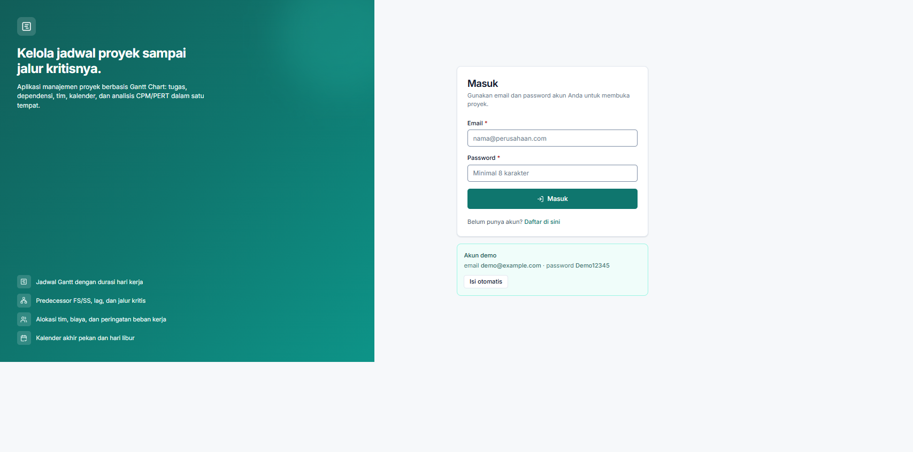
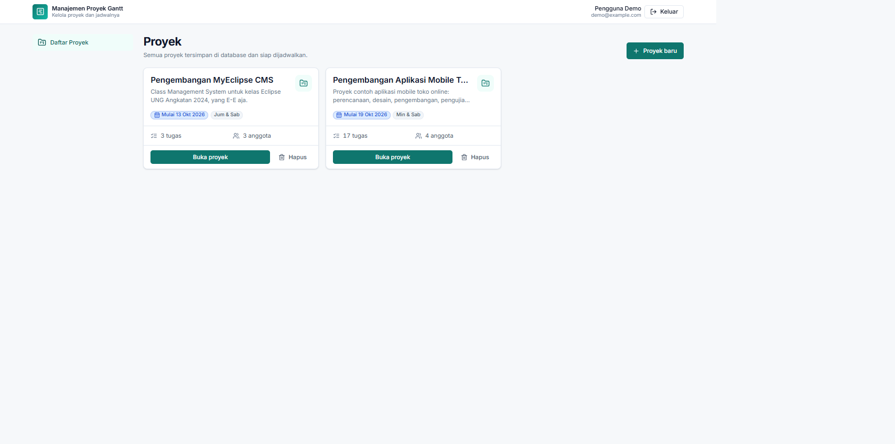
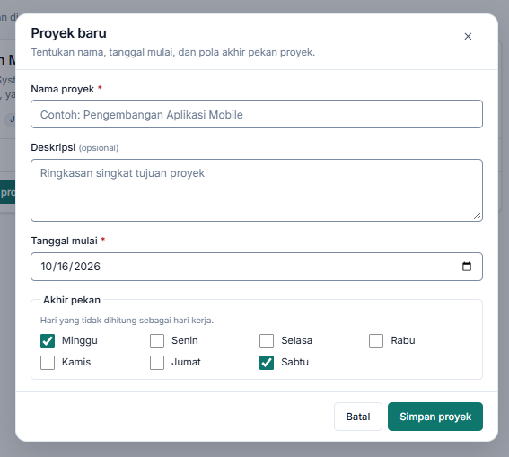
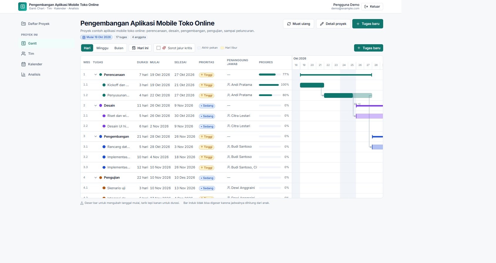
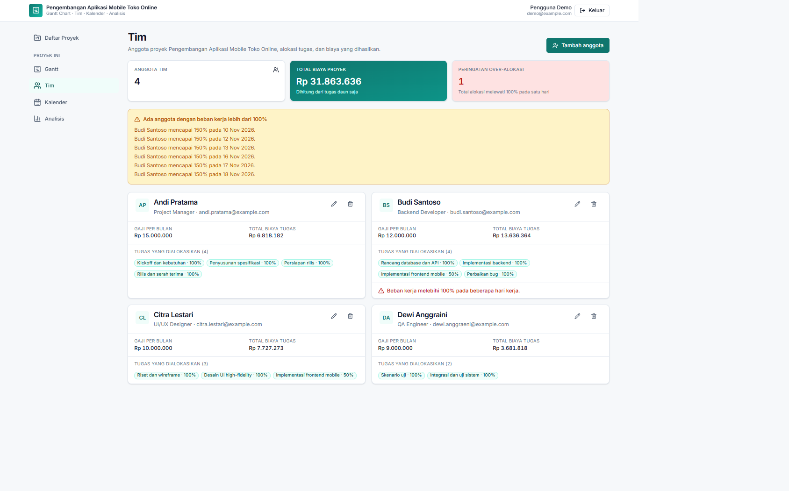
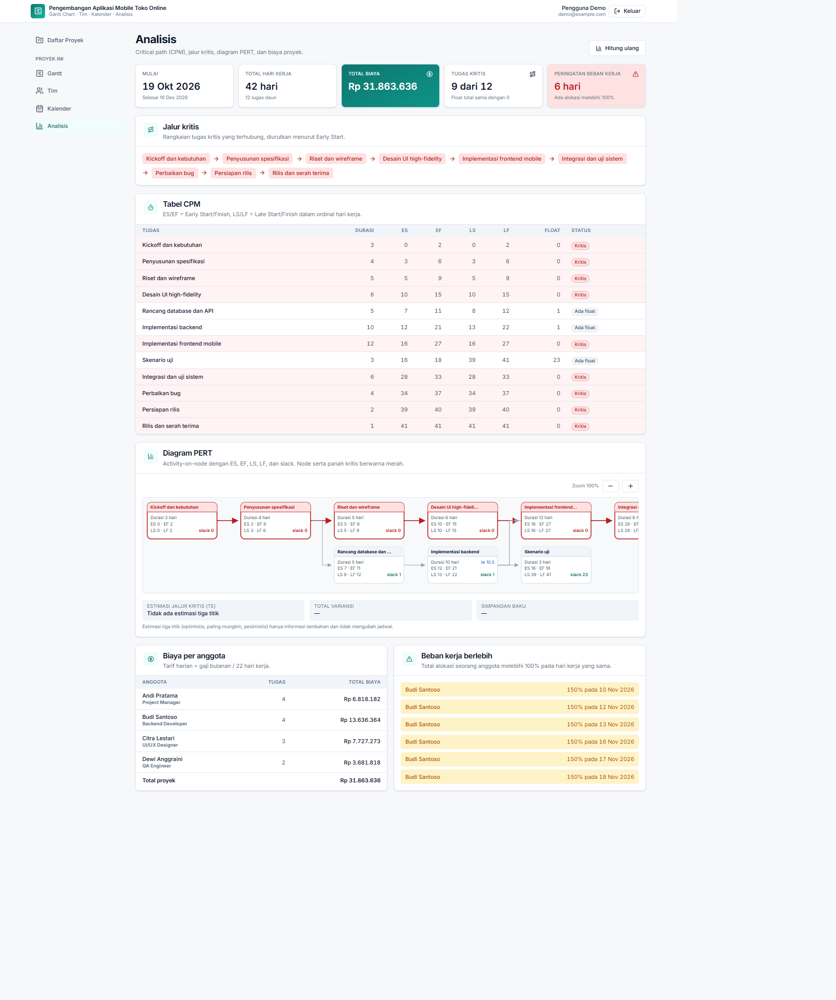

# Aplikasi Manajemen Proyek Gantt Chart

Aplikasi web manajemen proyek berbasis Gantt Chart: tugas dan sub-tugas, dependensi
Finish-to-Start (FS) dan Start-to-Start (SS) dengan jeda hari, alokasi tim beserta biaya,
kalender kerja (akhir pekan dan hari libur), serta analisis Critical Path (CPM) dan diagram PERT.
Seluruh data disimpan di database melalui REST API, bukan di penyimpanan browser.

Aplikasi dibangun mengikuti `blueprint.md` (spesifikasi) dengan acuan tampilan dari `DESIGN.md`.

## Fitur

- **Manajemen tugas** — tambah, ubah, hapus; durasi hari kerja; tanggal mulai paling awal;
  prioritas Low/Medium/High; warna indikator; progres; sub-tugas sampai 3 level dengan
  durasi, rentang, dan progres induk yang dihitung otomatis.
- **Predecessor dan timeline** — dependensi FS dan SS dengan lag dalam hari kerja, grafik Gantt
  berbasis SVG (bar berwarna, lapisan progres, bar induk bergaya bracket, arsiran akhir pekan dan
  hari libur, garis hari ini, zoom Hari/Minggu/Bulan), panah dependensi, geser bar untuk memindahkan
  tanggal, tarik tepi kanan untuk mengubah durasi, serta sorotan jalur kritis.
- **Manajemen sumber daya** — anggota tim (nama, email, peran, gaji), alokasi ke tugas dalam persen,
  biaya per tugas dan per anggota, peringatan over-alokasi.
- **Kalender proyek** — pengaturan tujuh hari akhir pekan, daftar hari libur khusus, dan kalender
  bulanan mini; durasi tugas hanya menghitung hari kerja dan jadwal dihitung ulang otomatis.
- **Analisis proyek** — ringkasan proyek, tabel CPM (ES, EF, LS, LF, float), daftar jalur kritis,
  diagram PERT yang bisa di-zoom dengan penanda kritis, biaya proyek, dan beban kerja tim.
- **Akun** — register, login, logout; data setiap pengguna terpisah dan setiap permintaan
  diperiksa kepemilikannya.

## Teknologi

| Lapisan | Teknologi |
| --- | --- |
| Frontend | React 18, TypeScript, Vite, Tailwind CSS, React Router, TanStack Query, react-hook-form, zod, lucide-react |
| Backend | Node.js, Express, TypeScript (tsx untuk dev), zod, jsonwebtoken, bcryptjs, helmet, cors, express-rate-limit |
| Database | SQLite dengan Prisma ORM (`server/prisma/dev.db`) |
| Logika inti | Paket `shared` (TypeScript murni): kalender, penjadwalan, CPM, PERT, biaya |
| Gantt dan PERT | Digambar sendiri dengan SVG, tanpa library Gantt eksternal |
| Test | Vitest, Supertest, Testing Library |
| Tooling | npm workspaces, concurrently |

Paket `shared` dipakai server dan client sekaligus, sehingga mesin penjadwalan yang menyimpan jadwal
ke database identik dengan yang dipakai untuk pratinjau saat bar digeser.

## Prasyarat

- Node.js 18 atau lebih baru (diuji pada Node 22) dan npm
- Git

## Instalasi

```bash
npm install
cp .env.example .env      # Windows (Git Bash): cp, atau salin manual
# lalu ganti JWT_SECRET di .env dengan string acak, misalnya hasil dari:
#   node -e "console.log(require('crypto').randomBytes(48).toString('hex'))"
npm run db:migrate        # membuat server/prisma/dev.db dan menjalankan migrasi
npm run db:seed           # mengisi data contoh (aman dijalankan berulang)
```

`JWT_SECRET` wajib diisi; server akan gagal start dengan pesan jelas bila kosong.
File `.env` dan seluruh file `*.db` sudah diabaikan oleh Git.

## Menjalankan aplikasi

```bash
npm run dev
```

- Antarmuka: <http://localhost:5173>
- API: <http://localhost:3001/api> (health check: <http://localhost:3001/api/health>)

Vite mem-proxy `/api` ke server, jadi cukup membuka alamat antarmuka.

**Akun demo:** `demo@example.com` / `Demo12345` (memiliki proyek contoh
"Pengembangan Aplikasi Mobile Toko Online" berisi 17 tugas, 4 anggota tim, dan 2 hari libur).



## Tampilan antarmuka

Tangkapan layar di bawah diambil dari aplikasi yang berjalan dengan data contoh.
Berkasnya ada di folder [`ui/`](ui/).

### Beranda

Halaman pertama setelah masuk: daftar proyek pengguna, tempat proyek dibuat, dibuka, atau dihapus.



### Membuat proyek

Dialog **Proyek baru** dari tombol di beranda: nama, deskripsi, tanggal mulai, dan pilihan hari akhir pekan.



### Halaman Gantt

Tabel tugas (WBS, durasi, progres) berdampingan dengan timeline SVG: bar tugas dan induk, panah
dependensi, arsiran akhir pekan dan hari libur, garis hari ini, zoom, serta sorotan jalur kritis.



### Halaman Tim

Anggota tim beserta peran dan gaji, alokasi ke tugas dalam persen, biaya per tugas dan per anggota,
serta peringatan over-alokasi.



### Halaman Analisis

Ringkasan proyek, tabel CPM (ES, EF, LS, LF, float), daftar jalur kritis, diagram PERT,
biaya proyek, dan beban kerja tim.



## Test dan build

```bash
npm run typecheck   # tsc --noEmit di semua workspace
npm test            # vitest di semua workspace
npm run build       # build shared, server, dan client
```

Test server memakai database SQLite terpisah (`server/prisma/test.db`) yang dibuat otomatis dari
migrasi saat test dijalankan.

Perintah database lain:

```bash
npm run db:migrate  # terapkan migrasi
npm run db:seed     # isi ulang data contoh
npm run db:reset    # hapus database, migrasi ulang, lalu seed
```

## Struktur repository

```
├─ ui/            tangkapan layar antarmuka untuk README
├─ shared/src/    dates, calendar, scheduler, cpm, pert, cost, schemas, types (+ *.test.ts)
├─ server/
│   ├─ prisma/    schema.prisma, migrations/, seed.ts
│   └─ src/       index.ts, app.ts, config.ts, db.ts, middleware/, routes/, services/, tests/
└─ client/
    └─ src/       api/, lib/, pages/, components/{ui,layout,gantt,pert}, test/, styles/
```

## Ringkasan API

Semua rute memakai prefiks `/api`. Selain `POST /auth/register`, `POST /auth/login`, dan
`GET /health`, seluruh rute memerlukan header `Authorization: Bearer <token>` dan hanya boleh
mengakses data milik pengguna yang sedang masuk (selain itu dijawab `404`).

| Method dan path | Fungsi |
| --- | --- |
| GET `/health` | Cek server hidup |
| POST `/auth/register` | Daftar akun (name, email, password minimal 8 karakter) |
| POST `/auth/login` | Masuk, mengembalikan token dan data pengguna |
| GET `/auth/me` | Data pengguna saat ini |
| GET, POST `/projects` | Daftar dan buat proyek |
| GET, PATCH, DELETE `/projects/:id` | Snapshot lengkap proyek, ubah, hapus |
| POST `/projects/:id/tasks` | Buat tugas (boleh dengan `parentId`) |
| PATCH, DELETE `/tasks/:id` | Ubah tugas (jadwal dihitung ulang), hapus beserta anaknya |
| POST `/tasks/:id/move` | Ubah induk dan posisi tugas |
| POST `/tasks/:id/dependencies` | Tambah predecessor (predecessorId, type, lagDays) |
| PATCH, DELETE `/dependencies/:id` | Ubah atau hapus dependensi |
| GET, POST `/projects/:id/resources` | Daftar dan tambah anggota tim |
| PATCH, DELETE `/resources/:id` | Ubah atau hapus anggota |
| POST `/tasks/:id/assignments` | Alokasikan anggota (resourceId, allocationPercent) |
| PATCH, DELETE `/assignments/:id` | Ubah atau hapus alokasi |
| PUT `/projects/:id/calendar` | Atur akhir pekan, jadwal dihitung ulang |
| POST `/projects/:id/holidays` | Tambah hari libur (date, name) |
| DELETE `/holidays/:id` | Hapus hari libur |
| GET `/projects/:id/analysis` | Hasil CPM, jalur kritis, data PERT, biaya, beban resource |

Format error: `{ "error": { "code": "...", "message": "pesan bahasa Indonesia", "details": {} } }`
dengan status `400/422` (validasi), `401` (belum masuk), `404` (tidak ditemukan), `409` (konflik).
Setiap mutasi yang mengubah jadwal mengembalikan `{ "tasks": [...] }` berisi seluruh tugas terbaru.

Aturan penjadwalan yang diuji (vektor uji blueprint 6.11): mulai Jumat 2026-10-23 dengan durasi 3
hari kerja berakhir Selasa 2026-10-27; penerus FS lag 0 mulai Rabu 2026-10-28; penerus SS lag 2
mulai Selasa 2026-10-27; dengan libur Senin 2026-10-26 durasi 3 hari berakhir Rabu 2026-10-28;
untuk jaringan A(3) → B(2), A → C(5), B dan C → D(1) diperoleh A, C, D kritis, B float 3, PE = 8.

## Catatan desain

```
Design Notes
- Register · archetype: Product · Admin/back-office (runner-up: Productivity/tasks)
- Dials: Density 8 · Expressiveness 3 · Motion 2
- Tokens: brand teal #0F766E · netral slate · Inter · radius 6/10/16 · shadow sm/md/lg
- Layar tambahan (tidak diminta spesifikasi): halaman 404, dialog detail proyek,
  dialog konfirmasi hapus, state loading/empty/error, notifikasi toast
- Kebutuhan backend tambahan: tidak ada
```

## Asumsi

1. Semua tugas pada data contoh memakai tanggal mulai paling awal yang sama dengan tanggal mulai
   proyek; jadwal sebenarnya ditentukan oleh dependensi.
2. Panel tabel dan timeline Gantt diletakkan dalam satu wadah yang dapat di-scroll, dengan kolom
   tabel menempel (sticky) di kiri. Dengan cara ini kedua panel selalu scroll vertikal secara
   sinkron tanpa perlu menyinkronkan dua wadah terpisah.
3. Pada layar kecil tabel tugas hanya menampilkan kolom utama (WBS, nama, durasi); kolom lain
   tersedia di dialog tugas dan timeline tetap dapat digeser horizontal.
4. Sorotan jalur kritis di halaman Gantt dihitung di client memakai fungsi `computeCpm` dari paket
   `shared` berdasarkan data snapshot yang sudah ada, tanpa permintaan API tambahan.
5. Bila ada beberapa cabang kritis yang sama panjang, "jalur kritis" menampilkan satu rantai
   terpanjang yang dimulai dari Early Start paling awal.
6. Estimasi optimistis/pesimistis hanya bersifat informasi. Total variansi dan simpangan baku
   dihitung di sepanjang jalur kritis; bila tidak ada tugas kritis yang punya estimasi, nilainya
   `null` (ditampilkan sebagai tanda "—").
7. `weekendDays` disimpan sebagai teks `"0,6"` di database dan dikirim/diterima sebagai array angka
   pada API, sesuai blueprint bagian 5 dan 6.2.
8. Aturan yang menghasilkan konflik: menambahkan anak pada tugas yang sudah punya dependensi atau
   alokasi dijawab `409`; mengubah durasi, tanggal, atau progres pada tugas induk dijawab `422`;
   dependensi duplikat, ke diri sendiri, pada tugas induk, dan yang membentuk siklus dijawab `422`
   (kode `CYCLE_DETECTED` untuk siklus).
9. Mengganti tugas induk dari dialog tugas memakai endpoint `POST /tasks/:id/move` sesuai blueprint,
   bukan lewat `PATCH /tasks/:id`.
10. Login dan register dibatasi 30 permintaan per 15 menit per IP (batas konkretnya dipilih sendiri
    karena blueprint hanya mewajibkan pembatasan).
11. Versi pustaka yang dipakai: React 18, Express 4, Tailwind CSS 3, zod 3, Prisma 6, Vitest 2.
12. Deployment cloud, kolaborasi real-time, ekspor PDF, notifikasi email, dan multi-bahasa berada di
    luar cakupan.
13. Halaman login memuat font Inter dari Google Fonts; tanpa koneksi internet tampilan akan memakai
    font sistem.
